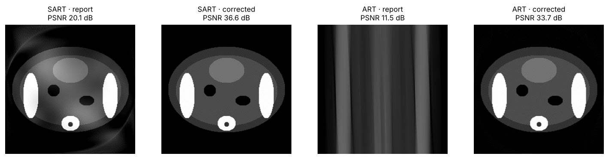
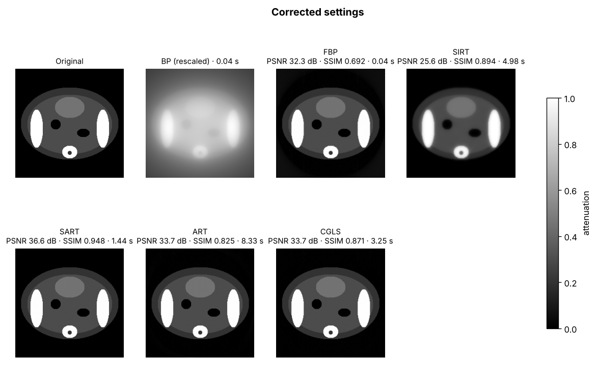
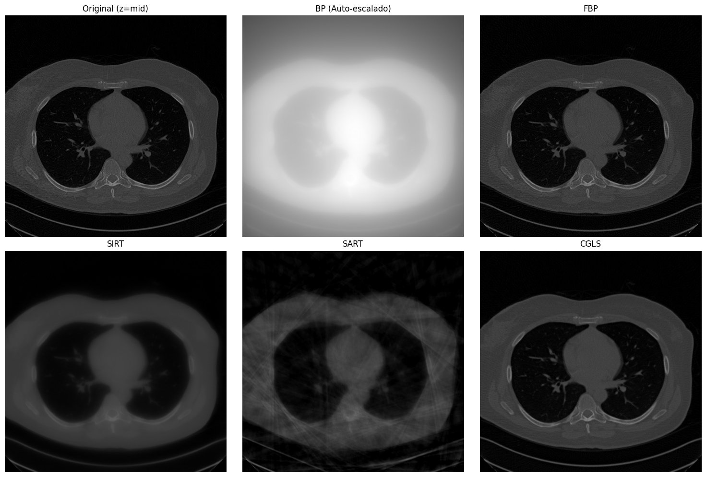
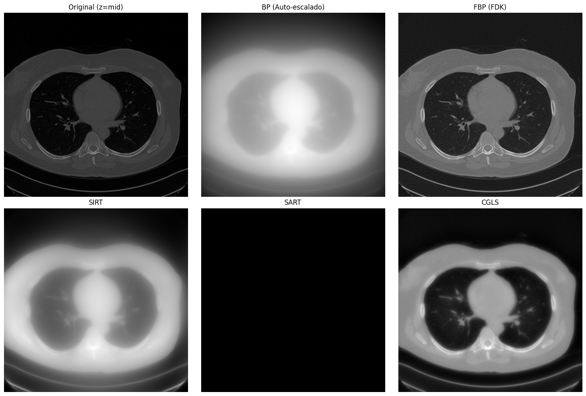

# CT Reconstruction in 2D and 3D with ASTRA Toolbox (GPU)

[](https://colab.research.google.com/github/diego-dupuy/ct-reconstruction-cuda/blob/main/notebooks/01_2d_pelvis.ipynb)


[](LICENSE)

**Diego Dupuy Álamo** · Biomedical Engineering, Universitat Politècnica de València

This project compares **analytic** methods (BP, FBP, FDK) and **iterative** methods (SIRT, SART, ART, CGLS)
for reconstructing CT images:

1. **2D:** a synthetic pelvis phantom that I designed (fat, muscle, bone, bladder and bowel gas).
2. **3D, fan beam:** a 512 × 512 × 280 thoracic CT reconstructed slice by slice on the GPU.
3. **3D, cone beam:** the same volume reconstructed all at once on the GPU, followed by a 3D bone surface.

It started as my project for the course *Técnicas de Imágenes Biomédicas* (prof. Gumersindo J. Verdú Martín).
I later reorganised the Colab code into this repository and fixed the errors I found while reviewing it.



## Results

### 2D pelvis phantom (256 × 256, 180 angles, CPU)

PSNR and SSIM compare each reconstruction with the original phantom (higher is better).

| Method | Iterations | Time (s) | PSNR (dB) | SSIM |
|---|---|---|---|---|
| FBP | – | 0.04 | 32.3 | 0.69 |
| SIRT | 50 | 5.0 | 25.6 | 0.89 |
| SART (corrected) | 10 passes | 1.4 | **36.6** | **0.95** |
| ART (corrected) | 20 passes | 8.3 | 33.7 | 0.83 |
| CGLS | 30 | 3.2 | 33.7 | 0.87 |



### 3D thoracic CT (512 × 512 × 280, Google Colab, Tesla T4 GPU)

Total GPU time to reconstruct the whole volume:

| Method | Fan beam, slice by slice | Cone beam, whole volume |
|---|---|---|
| BP | 1.87 s | 0.59 s |
| FBP / FDK | 2.58 s | **0.93 s** |
| SIRT | 60.44 s (30 it.) | 9.02 s (5 it.) |
| SART | 4.25 s (30 it.) | not available in ASTRA |
| CGLS | 41.58 s (20 it.) | 16.80 s (10 it.) |

FDK reconstructs the whole volume in under a second, 2.8× faster than FBP slice by slice. CGLS takes about 18× longer than FDK,
but gives less noise and better soft-tissue contrast.

| Fan beam (central slice) | Cone beam (central slice) |
|---|---|
|  |  |

## What I fixed when I reviewed the original code

1. **ART and SART were under-iterated.** ASTRA counts *one SART iteration as one angle* and *one ART iteration as one ray*.
   My "1000 iterations" of ART were only 2 % of a single pass over the data, which caused the vertical bands.
   I now count iterations in full passes, and SART uses a random angle order. Result: SART 20.1 → 36.6 dB, ART 11.5 → 33.7 dB.
2. **The cone-beam "memory error" was a missing algorithm.** `SART3D_CUDA` does not exist in ASTRA (the error says
   *Unknown algorithm type*). My code caught every error and printed "out of VRAM", which hid the real cause.
3. **The cone-beam detector was too small.** The cone magnifies the volume vertically too (×1.67–2.18), so 280
   detector rows cut off the top and bottom slices. The code now calculates the number of rows needed (611).
4. **CGLS converges early:** 30 iterations give practically the same image as 100, in a third of the time.

## How to run it

**In Colab (easiest):** open a notebook with the badge, choose *Runtime → Change runtime type → T4 GPU*
for notebooks 02 and 03, and run all cells. The 3D notebooks read `datos_ct.mat` from your Google Drive.
This clinical file was provided by the course and is not included in the repository.

| Notebook | Needs |
|---|---|
| [01_2d_pelvis](notebooks/01_2d_pelvis.ipynb) | CPU |
| [02_3d_fanbeam](notebooks/02_3d_fanbeam.ipynb) | GPU + `datos_ct.mat` |
| [03_3d_conebeam](notebooks/03_3d_conebeam.ipynb) | GPU + `datos_ct.mat` |

**Locally:**

```bash
git clone https://github.com/diego-dupuy/ct-reconstruction-cuda.git
cd ct-reconstruction-cuda
pip install -r requirements.txt
python -m pytest        # quick checks
```

## Project structure

```
src/
├── phantom.py          # pelvis phantom from ellipses
├── data.py             # load and normalise datos_ct.mat
├── reconstruction.py   # 2D, fan-beam slice-by-slice and cone-beam 3D with ASTRA
├── metrics.py          # RMSE, PSNR, SSIM
└── visualization.py    # comparison grids, error maps, 3D bone surface
notebooks/              # 01 (2D), 02 (fan beam), 03 (cone beam)
tests/                  # basic checks, run automatically on GitHub
```

## References

Andersen, A. H., & Kak, A. C. (1984). Simultaneous algebraic reconstruction technique (SART): A superior implementation of the ART algorithm. *Ultrasonic Imaging, 6*(1), 81–94. https://doi.org/10.1177/016173468400600107

Feldkamp, L. A., Davis, L. C., & Kress, J. W. (1984). Practical cone-beam algorithm. *Journal of the Optical Society of America A, 1*(6), 612–619. https://doi.org/10.1364/JOSAA.1.000612

Lorensen, W. E., & Cline, H. E. (1987). Marching cubes: A high resolution 3D surface construction algorithm. *ACM SIGGRAPH Computer Graphics, 21*(4), 163–169. https://doi.org/10.1145/37402.37422

van Aarle, W., Palenstijn, W. J., Cant, J., Janssens, E., Bleichrodt, F., Dabravolski, A., De Beenhouwer, J., Batenburg, K. J., & Sijbers, J. (2016). Fast and flexible X-ray tomography using the ASTRA toolbox. *Optics Express, 24*(22), 25129–25147. https://doi.org/10.1364/OE.24.025129
